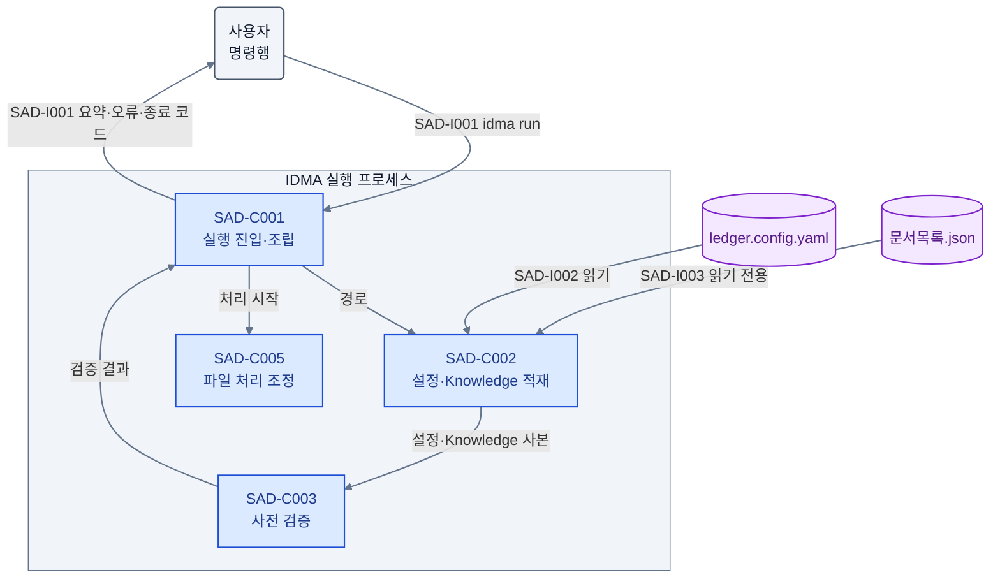
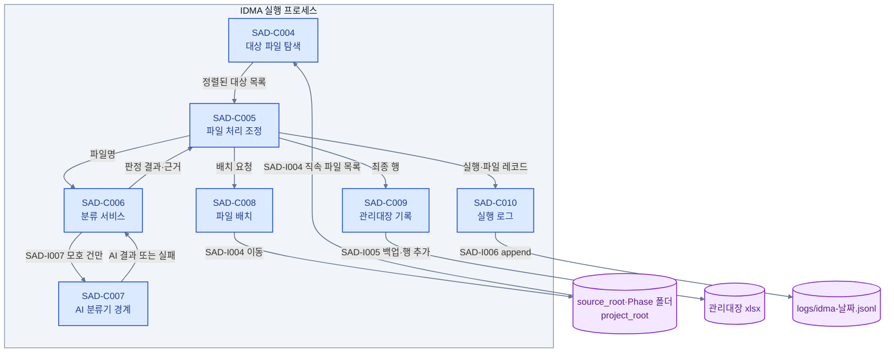

# SAD: IDMA 제출물 관리대장 자동화 시스템
SRS 요구를 현행 `src/app` 패키지 구조 위의 컴포넌트·외부 경계·품질 수단으로 배치한 아키텍처 기술서다.

## 개요
온디맨드 단일 프로세스 CLI와 로컬 설정 GUI의 구조, 그리고 되돌리기 어려운 결정 4건을 정의한다.

This SAD is the final design document for IDMA. It describes the architecture structure (views `<SAD-W001>`, `<SAD-W002>`) and the hard-to-reverse decisions `<SAD-R001>`–`<SAD-R004>`. Implementation below this level is developer judgment within this SAD unless the user explicitly requests otherwise. `docs/3.Design/SDD.md` is not gate-checked; its planned package names (`knowledge/`, `config/`, `scanner.py`, ...) do not exist in the code and are not used here.

- 상태: 초안 (`00.01`), 사용자 합의 근거 없음.
- 범위: the `src/app` Python package — one CLI run process (`idma run`) and one local settings GUI process (`idma ui`) on a local Windows PC; the files they read and write (`ledger.config.yaml`, `문서목록.json`, `source_root`, Phase folders, `project_root`, ledger workbook, `logs/`); and the AI classifier contract boundary.

Inputs: [PRD](../1.Concept/PRD.md) revision `00.01`, [SRS](../2.Requirement/SRS.md) revision `00.01`, and the code under `src/app` as of this revision.

Component placement follows the existing layering of `src/app`: `core/` holds domain types, protocols and use-case logic and imports no adapter; `adapters/` holds file, workbook, log, watcher and AI implementations; `models/` holds the runtime config model and default config files; `ui/` holds the Tkinter window; `main.py` assembles everything. The code was produced before the current SRS (see `docs/notes/LLM작업/완료/Codex 1차 자동빌드 결과물.md`) and deviates from it in several places. Those deviations are listed in `현행 코드 대응` under `<SAD-W001>` as implementation-stage work; this SAD follows the SRS wherever the two differ.

## 이해관계자와 관심사
실무 사용자·Knowledge 관리자·도입 책임자·개발자·유지보수자와 그 관심사를 정의한다.

```
[SAD-S001] 제출물 접수·관리 담당자
Role: user (non-developer practitioners included; runs the CLI and the settings UI)
- 관심사: `<SAD-K001>`, `<SAD-K002>`, `<SAD-K003>`, `<SAD-K004>`
```

```
[SAD-S002] Knowledge 관리자
Role: user (edits `문서목록.json` by hand; may be the same person as `<SAD-S001>`)
- 관심사: `<SAD-K005>`
```

```
[SAD-S003] 도입 책임자
Role: acquirer (project owner deciding to replace manual filing and ledger entry)
- 관심사: `<SAD-K001>`, `<SAD-K003>`, `<SAD-K006>`
```

```
[SAD-S004] 개발자
Role: developer
- 관심사: `<SAD-K006>`, `<SAD-K007>`
```

```
[SAD-S005] 유지보수자
Role: maintainer (extends Phases/artifacts and swaps the AI implementation)
- 관심사: `<SAD-K005>`, `<SAD-K007>`
```

```
[SAD-K001] 분류·배치 적합성
Files dropped into `source_root` reach the correct Phase folder by file name alone, with Rule first and AI only for unresolved cases.
```

```
[SAD-K002] 파일 무유실
No run path leaves an input file in zero locations; a failed classification or a system error never deletes or overwrites a file.
```

```
[SAD-K003] 감사 추적성
Every processed file leaves one ledger row and one log record explaining method, evidence, final path and status.
```

```
[SAD-K004] 비개발자 설정 편집
Paths, thresholds and policies are edited and validated in a local GUI without opening YAML.
```

```
[SAD-K005] Knowledge 소유권과 불변성
`문서목록.json` stays under human control; the system never writes it, and edits take effect on the next run without a sync step.
```

```
[SAD-K006] 실현가능성·위험
The system runs on a local Windows PC with Python 3.11+ and keeps working when no AI implementation is available.
```

```
[SAD-K007] 확장성·유지보수성
New Phases need only config and Knowledge edits; the AI implementation can be replaced without changing callers; path resolution is CWD-independent.
```

## 뷰포인트
런타임 구조 뷰포인트와 설정 편집 뷰포인트 두 개로 모든 관심사를 커버한다.

```
[SAD-V001] 런타임 구조 뷰포인트
대상 이해관계자: `<SAD-S001>`, `<SAD-S003>`, `<SAD-S004>`, `<SAD-S005>`
대상 관심사: `<SAD-K001>`, `<SAD-K002>`, `<SAD-K003>`, `<SAD-K005>`, `<SAD-K006>`, `<SAD-K007>`
언어/기법: Mermaid flowchart (component-connector), component/interface/quality item lists
출처: self-defined (component-and-connector style)
```

```
[SAD-V002] 설정 편집 뷰포인트
대상 이해관계자: `<SAD-S001>`, `<SAD-S002>`, `<SAD-S005>`
대상 관심사: `<SAD-K004>`, `<SAD-K005>`
언어/기법: Mermaid flowchart (component-connector), component/interface item lists
출처: self-defined
```

뷰포인트 선정 근거: the CLI run and the settings GUI are separate processes with separate users of their output, so the run-time pipeline (`<SAD-V001>`) and the configuration edit path (`<SAD-V002>`) are described separately. Every stakeholder `<SAD-S001>`–`<SAD-S005>` and every concern `<SAD-K001>`–`<SAD-K007>` is covered by at least one of them (see `추적성`).

## 뷰
런타임 파이프라인과 설정 편집 경로를 컴포넌트·외부 경계·품질속성으로 보인다.

### [SAD-W001] 런타임 구조 뷰 (대응: `<SAD-V001>`)
1회 실행 CLI가 설정·Knowledge를 읽고 파일을 1건씩 분류·배치·기록하는 구조다. 상주 감시 대신 단순한 1회 실행을 택해 실시간성을 포기한다.

대응: `<SAD-V001>`

#### FIG-SAD-001 · 실행 준비와 종료
CLI 진입이 설정·Knowledge를 적재하고 사전 검증을 통과해야만 파일 처리를 시작함을 보인다.



범례: 파랑=컴포넌트, 보라=파일, 회색=사용자. 실선=정보 전달.

#### FIG-SAD-002 · 파일 1건 처리
처리 조정 컴포넌트가 탐색·분류·배치·기록 컴포넌트를 순서대로 호출하고 각 외부 저장소와 만나는 지점을 보인다.



범례: 파랑=컴포넌트, 보라=외부 파일·폴더. 실선=정보 전달. 분기 조건과 실패 동작은 아래 경계 정의를 따른다.

#### 컴포넌트
실행 진입부터 로그까지 10개 컴포넌트의 책임과 비책임을 SRS에 연결한다.

```
[SAD-C001] 실행 진입·조립
구현요건: `<SRS-F004>`, `<SRS-F025>`, `<SRS-N008>`
Process entry point. Parses the `idma run` / `idma ui` command line, locates `ledger.config.yaml`, wires core and adapter components, starts one run and maps the run outcome to the exit code.
- 책임: CLI parsing (`<SAD-I001>`); dependency assembly; blocking the run with exit code 1 when `<SAD-C003>` reports any failure; exit code 2 when `<SAD-C009>` reports the workbook inaccessible; exit code 3 when any file ended in `Error`; printing the summary to stdout and every cause message to stderr; launching `<SAD-C011>` for `idma ui`
- 비책임: file classification (`<SAD-C006>`), per-file orchestration (`<SAD-C005>`), validation rules (`<SAD-C003>`)
- 현행 모듈: `src/app/main.py`
```

```
[SAD-C002] 설정·Knowledge 적재
구현요건: `<SRS-F001>`, `<SRS-F002>`, `<SRS-F003>`, `<SRS-F005>`, `<SRS-F006>`
Loads `ledger.config.yaml` into the runtime config model and `문서목록.json` into an in-memory Knowledge copy once per run, and owns the single path-resolution rule.
- 책임: YAML/JSON parsing into immutable models; resolving every relative path against `project_root` (and a relative `project_root` against the config file directory); writing `ledger.config.yaml` only on behalf of `<SAD-C011>` after validation, preserving keys outside the 8 required ones; exposing all thresholds, policies, Phases and artifacts from files rather than code constants
- 비책임: validating values (`<SAD-C003>`); any write, rename or delete of `문서목록.json` (no such operation exists); caching Knowledge outside the process
- 현행 모듈: `src/app/adapters/config_loader.py`, `src/app/models/config_schema.py`
```

```
[SAD-C003] 사전 검증
구현요건: `<SRS-F004>`, `<SRS-F042>`
Owns the configuration and Knowledge validation rule set used before a run and before a UI save.
- 책임: the 5 ordered pre-run checks of `<SRS-F004>` (config keys, Knowledge schema and abbr uniqueness, Phase key set equality, path existence/access, value ranges) plus the ledger header check of SRS §8.4; the save-time checks of `<SRS-F042>`; returning every failed item with its cause
- 비책임: deciding exit codes or showing messages (`<SAD-C001>`, `<SAD-C011>`); loading files (`<SAD-C002>`)
- 현행 모듈: `src/app/core/validation.py`
```

```
[SAD-C004] 대상 파일 탐색
구현요건: `<SRS-F007>`, `<SRS-F008>`
Collects processing targets from `source_root` once per run.
- 책임: listing direct regular files only (no recursion, no directories, symlinks, names starting with `.` or `~$`, or 0-byte files); ordering them by case-insensitive code-point file name; reporting an empty set so the run ends with exit code 0 and no ledger change
- 비책임: watching the folder continuously (excluded by `<SAD-R002>`); classification or movement (`<SAD-C006>`, `<SAD-C008>`)
- 현행 모듈: none conforming; `src/app/adapters/file_watcher.py` is a resident watcher (see `현행 코드 대응`)
```

```
[SAD-C005] 파일 처리 조정
구현요건: `<SRS-F008>`, `<SRS-F022>`, `<SRS-F023>`, `<SRS-F025>`, `<SRS-F026>`, `<SRS-F031>`, `<SRS-F032>`
Use case that drives one file through classify -> place -> ledger -> log and owns the per-file state.
- 책임: sequential processing where one file's exception becomes that file's `Error` and processing continues; the state paths of `<SRS-F026>`; choosing Phase folder, `project_root` (Fallback) or leave-in-place (`fallback.enabled=false`, `Error`); building the final ledger row (`classification_method` domain, `ai_confidence` only for `AI`, empty `phase`/`artifact_abbr` for Fallback); writing `Filed` only after a successful move
- 비책임: matching rules (`<SAD-C006>`), filesystem operations (`<SAD-C008>`), workbook I/O (`<SAD-C009>`), log formatting (`<SAD-C010>`)
- 현행 모듈: `src/app/core/usecases.py` (types in `src/app/core/entities.py`)
```

```
[SAD-C006] 분류 서비스
구현요건: `<SRS-F010>`, `<SRS-F011>`, `<SRS-F012>`, `<SRS-F013>`, `<SRS-F014>`, `<SRS-F016>`, `<SRS-F035>`
Deterministic Rule Engine plus the gate that decides whether to call AI and whether to adopt its answer.
- 책임: tokenization of `<SRS-F010>`; abbr exact match (priority 1, confidence 1.0); full_name word ratio with the 0.8/0.6 grades and min-ratio filter; tie handling; the 3 AI call conditions of `<SRS-F014>`; the 4 adoption conditions of `<SRS-F016>`; producing the method, confidence and `match_evidence` for every outcome
- 비책임: AI implementation details (`<SAD-C007>`); file placement (`<SAD-C008>`); reading Knowledge from disk (`<SAD-C002>`)
- 현행 모듈: `src/app/core/rule_engine.py`
```

```
[SAD-C007] AI 분류기 경계
구현요건: `<SRS-F015>`, `<SRS-F017>`
Single abstract AI classifier contract and its pluggable implementation.
- 책임: exposing only `classify(filename, artifacts) -> AIResult | None` (`<SAD-I007>`); passing the file name only, never file content; turning an exception, `None` or a response slower than 30 s into an AI failure for that file only
- 비책임: deciding when to call or whether to adopt (`<SAD-C006>`); Fallback placement (`<SAD-C005>`)
- 현행 모듈: protocol `AIClassifier` in `src/app/core/entities.py`; implementation `StubAIClassifier` in `src/app/adapters/ai_client.py` (always returns `None`)
```

```
[SAD-C008] 파일 배치
구현요건: `<SRS-F020>`, `<SRS-F021>`, `<SRS-F022>`, `<SRS-F024>`
Moves one file to its decided directory without overwriting or losing it.
- 책임: creating the target directory; move (not copy) keeping the original name; `_<n>` duplicate suffix from `duplicate.suffix_start` up to `suffix_start + 999`; leaving no partial copy and keeping the original in `source_root` on any move failure; returning the final absolute path or the failure cause
- 비책임: choosing the target directory (`<SAD-C005>`); ledger or log writes (`<SAD-C009>`, `<SAD-C010>`)
- 현행 모듈: `src/app/adapters/file_ops.py`
```

```
[SAD-C009] 관리대장 기록
구현요건: `<SRS-F030>`, `<SRS-F033>`
Appends final result rows to the existing ledger workbook.
- 책임: backing up the workbook to `project_root/backup/<name>_<run_id>.xlsx` before opening; detecting an exclusive lock and reporting it before any file moves (exit code 2 via `<SAD-C001>`); locating the 8 columns by header name; appending rows below the last data row without changing existing rows, sheets, formulas or formats
- 비책임: deciding row values (`<SAD-C005>`); creating or repairing headers or sheets (a missing header blocks the run in `<SAD-C003>`)
- 현행 모듈: `src/app/adapters/excel_repo.py`
```

```
[SAD-C010] 실행 로그
구현요건: `<SRS-F034>`, `<SRS-F035>`, `<SRS-F036>`
Writes run-level and file-level JSON Lines records.
- 책임: one `type: "run"` record and one `type: "file"` record per processed file under a shared `run_id`, with the fields of SRS §8.5 including `match_evidence` and `is_fallback`; appending to `project_root/logs/idma-<YYYYMMDD>.jsonl` (UTF-8, `\n`); creating `logs/`; turning a log write failure into a stderr warning without stopping processing
- 비책임: building the evidence content (`<SAD-C006>`); ledger rows (`<SAD-C009>`)
- 현행 모듈: `src/app/adapters/logger.py`
```

#### 외부 인터페이스
명령행·설정·Knowledge·파일시스템·워크북·로그·AI 경계의 형식과 실패 동작을 정의한다.

```
[SAD-I001] 명령행 경계
구현요건: `<SRS-F004>`, `<SRS-F007>`, `<SRS-F025>`, `<SRS-F033>`, `<SRS-N008>`
`idma run [--config <path>] [--dry-run]`, `idma ui [--config <path>]` (SRS §8.1)
- 입력: optional config path; when omitted, `ledger.config.yaml` in the CWD is used only to locate the file, never as a path base
- 출력: stdout summary (target count, count per method, `Error` count); `--dry-run` prints decisions and planned paths only and moves no file, writes no ledger row and saves no config, but still logs
- 실패 시 동작: exit 0 = normal (including 0 targets); 1 = pre-run validation or config failure, before any move; 2 = ledger workbook locked or not accessible, before any move; 3 = at least one file ended in `Error`. Every non-zero exit writes a cause message to stderr and the log
```

```
[SAD-I002] Runtime Config 파일 경계
구현요건: `<SRS-F002>`, `<SRS-F003>`, `<SRS-F006>`, `<SRS-F043>`
`ledger.config.yaml`, YAML, schema of SRS §8.2 (8 required keys, optional `config_version`, `workbook.sheet`)
- 입력: read once at run start by `<SAD-C002>`; written only by the UI save path
- 출력: on save, a temporary file is written and then swapped in; keys outside the schema are preserved
- 실패 시 동작: missing file or parse error blocks the run (exit 1); a failed save leaves the previous file intact and reports the cause in the UI
```

```
[SAD-I003] Knowledge 파일 경계
구현요건: `<SRS-F001>`, `<SRS-F005>`, `<SRS-N006>`
`문서목록.json`, JSON, `artifacts[]` of `{abbr, full_name, phase}` (SRS §8.3), resolved against `project_root`
- 입력: read-only, once per run and on UI display
- 출력: none; the system has no write path to this file
- 실패 시 동작: missing file, parse error, empty field or duplicate `abbr` blocks the run (exit 1)
```

```
[SAD-I004] 파일시스템 배치 경계
구현요건: `<SRS-F007>`, `<SRS-F020>`, `<SRS-F021>`, `<SRS-F022>`, `<SRS-F023>`, `<SRS-F024>`
Local or network/OneDrive-synced directories: `source_root` (read, move-out), Phase folders and `project_root` (move-in)
- 입력: direct regular files of `source_root`
- 출력: each file in exactly one of Phase folder, `project_root`, or `source_root`
- 실패 시 동작: permission, disk-space or path-length failure keeps the original in `source_root`, removes any partial target and marks the file `Error`; suffix exhaustion marks the file `Error`; other files continue
```

```
[SAD-I005] 관리대장 워크북 경계
구현요건: `<SRS-F030>`, `<SRS-F033>`
xlsx workbook at `workbook.path`, target sheet `workbook.sheet` (default `관리대장`), 8 header-named columns (SRS §8.4)
- 입력: existing workbook with the 8 headers present
- 출력: backup copy under `project_root/backup`; appended rows with final states only (`Ready`, `Filed`, `Error`)
- 실패 시 동작: exclusive lock -> exit 2 with a "close the ledger and re-run" message, no file moved; missing headers -> exit 1 via `<SAD-C003>`; a per-row write failure marks that file `Error`
```

```
[SAD-I006] 로그 파일 경계
구현요건: `<SRS-F034>`, `<SRS-F036>`
`project_root/logs/idma-<YYYYMMDD>.jsonl`, JSON Lines, append-only, schema of SRS §8.5
- 입력: run and file records from `<SAD-C010>`
- 출력: one JSON object per line
- 실패 시 동작: write failure prints a stderr warning; processing continues
```

```
[SAD-I007] AI 분류기 계약
구현요건: `<SRS-F015>`, `<SRS-F017>`
`classify(filename: str, artifacts: list[Artifact]) -> AIResult | None` (SRS §8.6); the implementation may be local or remote and is not visible to callers
- 입력: original file name with extension; Knowledge artifact list
- 출력: `artifact_abbr`, `phase`, `ai_confidence` in [0.0, 1.0]
- 실패 시 동작: exception, `None` or > 30 s -> AI failure for that file, then Fallback; never stops the run or other files
```

#### 품질속성
SRS 비기능 요구 8건을 구조적 수단과 확인 방법에 연결한다.

```
[SAD-Q001] 경로 해석 결정성
구현요건: `<SRS-N001>`, `<SRS-F003>`
Identical ledger rows (6 columns) across 3 different CWDs.
- 구조적 수단: `<SAD-C002>` is the only path resolver and its base is `project_root`; no other component builds paths from the CWD
- 확인 방법: regression test running the same inputs from 3 CWDs and comparing rows
```

```
[SAD-Q002] 설정 확장성
구현요건: `<SRS-N002>`, `<SRS-F006>`
A new Phase works with config and Knowledge edits only.
- 구조적 수단: Phases, artifacts, paths and thresholds reach `<SAD-C006>`/`<SAD-C005>` only through `<SAD-C002>` models (`<SAD-R001>`); code keeps only the confidence grades
- 확인 방법: regression test adding one Phase to config and Knowledge and checking placement
```

```
[SAD-Q003] AI 의존도 최소화
구현요건: `<SRS-N003>`, `<SRS-F014>`
Zero AI calls for files outside the 3 call conditions; Rule placement works without an AI implementation.
- 구조적 수단: the call gate lives in `<SAD-C006>` before `<SAD-I007>`; `<SAD-C007>` failure degrades to Fallback (`<SAD-R004>`)
- 확인 방법: regression test with ≥ 10 abbr-named files counting AI interface calls = 0, and a run with a failing AI implementation
```

```
[SAD-Q004] 파일 무유실
구현요건: `<SRS-N004>`, `<SRS-F024>`
Every target file exists in exactly one of 3 locations after the run.
- 구조적 수단: `<SAD-C008>` moves only after all decisions are final and never leaves partial copies; `<SAD-C005>` writes `Filed` only after a successful move; `<SAD-C009>` lock detection happens before any move
- 확인 방법: regression test for normal, Rule failure, AI failure and move exception scenarios comparing file counts and content hashes before and after
```

```
[SAD-Q005] 감사 추적성
구현요건: `<SRS-N005>`, `<SRS-F030>`, `<SRS-F034>`
Ledger row count = log file-record count = target count, each with method and evidence.
- 구조적 수단: `<SAD-C005>` emits exactly one final row to `<SAD-C009>` and one file record to `<SAD-C010>` per target, both carrying `<SAD-C006>` evidence
- 확인 방법: regression test comparing counts and checking `classification_method`/`match_evidence` presence
```

```
[SAD-Q006] Knowledge 불변성
구현요건: `<SRS-N006>`, `<SRS-F001>`, `<SRS-F041>`
`문서목록.json` hash, mtime and permissions unchanged by CLI and UI.
- 구조적 수단: `<SAD-C002>` offers no Knowledge write operation and `<SAD-C011>` has no Knowledge edit control (`<SAD-R001>`)
- 확인 방법: regression test comparing SHA-256 and mtime around a full pipeline run and a UI save
```

```
[SAD-Q007] 처리 성능
구현요건: `<SRS-N007>`
≤ 1 s per file excluding AI; 200 artifacts × 100 files in ≤ 60 s excluding AI, on local disk.
- 구조적 수단: Knowledge and config load once per run (`<SAD-C002>`); the workbook is opened once per run by `<SAD-C009>` rather than per row; Rule matching is in-memory
- 확인 방법: timed run with a 200-artifact Knowledge and 100 input files and a stub AI
```

```
[SAD-Q008] 오류 보고 완결성
구현요건: `<SRS-N008>`, `<SRS-F025>`
Every non-zero exit and every `Error` file has a cause message in stderr and the log.
- 구조적 수단: `<SAD-C001>` converts all run-level exceptions into exit codes with messages; `<SAD-C005>` records exception type and message in `error_message` and the file log record
- 확인 방법: tests per exit code 1/2/3 checking stderr and log contain a cause message, not only a traceback
```

#### 현행 코드 대응
SRS와 다른 현행 코드와 SRS 밖 현행 코드를 impl 단계 작업으로 기록한다.

The table records observed deviations of `src/app` from this SAD. They are implementation-stage work, not design alternatives.

| SAD 항목 | 현행 코드 | SRS 대비 차이 |
|---|---|---|
| `<SAD-C001>` | `main.py` | CLI is `--nogui`, `--ledger-config`, `--app-config`, `--knowledge`; no `run`/`ui` subcommands, no `--dry-run`, no exit codes 1/2/3 (exceptions propagate); GUI mode starts a resident watcher |
| `<SAD-C002>` | `config_loader.py`, `config_schema.py` | Knowledge read as nested `phases[].artifacts[]`, not SRS §8.3 `artifacts[]`; also loads `app.config.yaml` (watch settings); missing keys get defaults (e.g. `ai.confidence_threshold` 0.8) instead of blocking; `source_root` is used as given without `project_root` resolution; save writes a fixed key set |
| `<SAD-C003>` | `core/validation.py` | `full_name_min_ratio` accepts 0.0; no abbr uniqueness, access-right or ledger header check; requires Phase folders to exist (SRS creates them) |
| `<SAD-C004>` | `adapters/file_watcher.py` | watchdog/polling resident watcher with stabilization; no one-shot ordered scan |
| `<SAD-C005>` | `core/usecases.py` | `fallback.enabled=false` raises and yields `Error` instead of `Ready`; Fallback rows store `phase`/`artifact_abbr` = `Fallback`; `Error` rows are not appended to the ledger |
| `<SAD-C006>` | `core/rule_engine.py` | tokenizer splits on every non-ASCII-alphanumeric character instead of the `<SRS-F010>` delimiter set; condition 3 of `<SRS-F014>` (Rule-FULL below AI threshold) not applied; adoption conditions 2–3 of `<SRS-F016>` not checked; no `match_evidence` |
| `<SAD-C007>` | `ai_client.py` | stub only; 30 s timeout not enforced |
| `<SAD-C008>` | `adapters/file_ops.py` | copies (`shutil.copy2`), original stays in `source_root`; no suffix upper bound |
| `<SAD-C009>` | `adapters/excel_repo.py` | no backup; lock handled by 3 retries then exception, no exit 2; creates workbook, sheet and missing headers (changes structure) |
| `<SAD-C010>` | `adapters/logger.py` | file name `submission_automation_<YYYYMMDD>.jsonl`; event records without `run_id`, `type` or `match_evidence`; write failure is not caught |
| `<SAD-C011>` | `ui/settings_window.py` | saves by direct overwrite; no `<SRS-F042>` validation before save; also hosts watcher start/stop and tray icon |
| none | `adapters/project_doc_classifier.py` | project document-number lookup in an external xlsx before Rule; not defined in the SRS |
| none | `core/phase_resolver.py`, `core/logic.py`, `utils/helpers.py`, `adapters/adapter_example.py`, `models/model_example.py` | unused or template sample code; no SRS counterpart |

Code with no SRS counterpart (resident watcher, tray, project document classifier) is not architected here. Keeping any of it requires an SRS change first (`AGENTS.md` rule 3).

### [SAD-W002] 설정 편집 뷰 (대응: `<SAD-V002>`)
로컬 GUI가 Runtime Config만 검증 후 원자적으로 저장하고 Knowledge는 읽기 전용으로만 보이는 구조다. 편집 편의 대신 Knowledge 편집 기능을 의도적으로 뺀다.

대응: `<SAD-V002>`

#### FIG-SAD-003 · 설정 편집 경로
UI가 검증을 거쳐 설정 파일에만 쓰고 Knowledge 파일은 읽기만 함을 보인다.


범례: 파랑=컴포넌트, 보라=파일, 회색=사용자. 실선=정보 전달.

#### 컴포넌트
설정 UI 컴포넌트를 정의하고 공유 컴포넌트 `<SAD-C002>`, `<SAD-C003>`은 런타임 구조 뷰 정의를 따른다.

```
[SAD-C011] 설정 UI
구현요건: `<SRS-F040>`, `<SRS-F041>`, `<SRS-F042>`, `<SRS-F043>`
Local Tkinter window started by `idma ui`; edits Runtime Config only.
- 책임: view/edit of the 7 items of `<SRS-F040>` (path fields with direct input and folder picker; Phase mapping table with add/delete/edit); calling `<SAD-C003>` before save and showing each failed item; delegating the save to `<SAD-C002>`; optional read-only display of Knowledge
- 비책임: any Knowledge edit control or write; running classification (`<SAD-C001>`); validation rules (`<SAD-C003>`); file format and atomic replace (`<SAD-C002>`)
- 현행 모듈: `src/app/ui/settings_window.py`
```

#### 외부 인터페이스
사용자가 보는 GUI 창 경계를 정의한다.

```
[SAD-I008] 설정 GUI 경계
구현요건: `<SRS-F040>`, `<SRS-F041>`, `<SRS-F042>`
Local GUI window (SRS §8.7); no web server or remote access
- 입력: values for the 7 editable items and a save action
- 출력: success message; persisted values shown again after restart
- 실패 시 동작: validation failure shows each failed item and reason and writes nothing; a write failure leaves the previous config intact and shows the cause
```

## 뷰 간 일관성
두 뷰는 `<SAD-C002>`, `<SAD-C003>`을 공유하며 알려진 불일치 1건을 기록한다.

```
[SAD-X001] 런타임 구조 뷰·설정 편집 뷰 검증 범위 차이
`<SAD-C003>` applies the 5-item pre-run set of `<SRS-F004>` in `<SAD-W001>` but the save-time set of `<SRS-F042>` in `<SAD-W002>`. The save-time set does not check Knowledge schema details, abbr uniqueness or access rights, and requires `source_root` to exist while the pre-run set requires its parent directory to exist.
- 영향: a config the UI accepts can still be blocked by the next `idma run` (exit 1).
- 해소 계획: intentionally kept; both rule sets come from the SRS and the run-time check remains the final safeguard. Aligning them needs an SRS change.
```

## 아키텍처 근거
되돌리기 어려운 결정 4건만 근거·되돌림 비용과 함께 기록한다.

The structure keeps the existing `core/` (domain logic and protocols, no adapter imports) versus `adapters/` (file, workbook, log, AI implementations) split of `src/app`. That split lets the Rule Engine stay deterministic and lets the AI implementation, workbook library or log format change without touching `core/`. Component internals, library choices and test layout are developer judgment.

All four decisions restate constraints already fixed by SRS revision `00.01` (§5.2, §5.3, §8.2–§8.6, §9); none adds a requirement.

```
[SAD-R001] Knowledge와 Runtime Config를 두 파일로 분리하고 Knowledge는 읽기 전용
구현요건: `<SRS-F001>`, `<SRS-F002>`, `<SRS-F005>`, `<SRS-F006>`, `<SRS-N002>`, `<SRS-N006>`
- 결정: classification knowledge lives only in human-maintained `문서목록.json` (read-only to the system); operational settings live only in `ledger.config.yaml` (editable through the UI); no cache, database or code copy of either.
- 근거: separates the user-owned reference data from tunable settings so that neither the CLI nor the UI can corrupt Knowledge, and Phase additions need no code change.
- 되돌림 비용: 높음 — merging or making Knowledge writable changes both user-facing file contracts, the UI scope and the immutability tests; existing project folders' files must be migrated.
- 참조: ADR-001
- 영향 범위: `<SAD-C002>`, `<SAD-C003>`, `<SAD-C011>`, `<SAD-I002>`, `<SAD-I003>`
```

```
[SAD-R002] 상주 없는 온디맨드 1회 실행 프로세스
구현요건: `<SRS-F007>`, `<SRS-F008>`, `<SRS-F004>`
- 결정: `idma run` is a one-shot process that validates, scans `source_root` once, processes each file and exits with a code; `idma ui` is a separate local GUI process. No daemon, polling, scheduler registration or tray residency.
- 근거: SRS §5.2 and §9 exclude residency; a one-shot run gives a single validation point, a defined exit code, one `run_id` per log batch and one workbook open per run.
- 되돌림 비용: 높음 — a resident model changes the exit-code contract, the run/log record model, workbook lock handling and the user's operating procedure; it also needs stabilization and concurrency rules absent from the SRS.
- 참조: ADR-002
- 영향 범위: `<SAD-C001>`, `<SAD-C004>`, `<SAD-C009>`, `<SAD-C010>`, `<SAD-I001>`
```

```
[SAD-R003] 관리대장은 기존 xlsx 워크북에 행만 추가
구현요건: `<SRS-F030>`, `<SRS-F033>`
- 결정: the ledger of record is the user's existing xlsx workbook; the system backs it up, then only appends rows under 8 header-named columns, never altering existing rows, sheets, formulas or formats; there is no separate system database.
- 근거: the ledger is a shared business artifact that people already open and edit in Excel; append-only plus backup keeps their structure and makes every run recoverable.
- 되돌림 비용: 높음 — moving to a database or a system-owned file changes the user's deliverable, the lock/exit-2 contract and every audit query built on the workbook.
- 참조: ADR-003
- 영향 범위: `<SAD-C009>`, `<SAD-I005>`, `<SAD-C005>`
```

```
[SAD-R004] Rule 우선, AI는 단일 추상 계약 뒤의 보조 분류
구현요건: `<SRS-F014>`, `<SRS-F015>`, `<SRS-F017>`, `<SRS-N003>`
- 결정: the deterministic Rule Engine decides first; AI is called only under the 3 conditions of `<SRS-F014>`, only through the single `classify` contract, and any AI failure degrades to Fallback.
- 근거: keeps results reproducible and auditable, keeps the system usable without any AI implementation, and keeps vendor choice out of callers.
- 되돌림 비용: 높음 — making AI primary or exposing vendor APIs changes the meaning of `classification_method` and `match_evidence` in every ledger row and log, breaks determinism tests and couples core logic to one vendor.
- 참조: ADR-004
- 영향 범위: `<SAD-C006>`, `<SAD-C007>`, `<SAD-I007>`
```

## 추적성
SRS 요구 42건과 이해관계자·관심사가 SAD 항목에 모두 연결됨을 보인다.

| SRS 요구사항 | SAD 항목 |
|---|---|
| `<SRS-F001>` | `<SAD-C002>`, `<SAD-I003>`, `<SAD-Q006>`, `<SAD-R001>` |
| `<SRS-F002>` | `<SAD-C002>`, `<SAD-I002>`, `<SAD-R001>` |
| `<SRS-F003>` | `<SAD-C002>`, `<SAD-I002>`, `<SAD-Q001>` |
| `<SRS-F004>` | `<SAD-C001>`, `<SAD-C003>`, `<SAD-I001>`, `<SAD-R002>` |
| `<SRS-F005>` | `<SAD-C002>`, `<SAD-I003>`, `<SAD-R001>` |
| `<SRS-F006>` | `<SAD-C002>`, `<SAD-I002>`, `<SAD-Q002>`, `<SAD-R001>` |
| `<SRS-F007>` | `<SAD-C004>`, `<SAD-I001>`, `<SAD-I004>`, `<SAD-R002>` |
| `<SRS-F008>` | `<SAD-C004>`, `<SAD-C005>`, `<SAD-R002>` |
| `<SRS-F010>` | `<SAD-C006>` |
| `<SRS-F011>` | `<SAD-C006>` |
| `<SRS-F012>` | `<SAD-C006>` |
| `<SRS-F013>` | `<SAD-C006>` |
| `<SRS-F014>` | `<SAD-C006>`, `<SAD-Q003>`, `<SAD-R004>` |
| `<SRS-F015>` | `<SAD-C007>`, `<SAD-I007>`, `<SAD-R004>` |
| `<SRS-F016>` | `<SAD-C006>` |
| `<SRS-F017>` | `<SAD-C007>`, `<SAD-I007>`, `<SAD-R004>` |
| `<SRS-F020>` | `<SAD-C008>`, `<SAD-I004>` |
| `<SRS-F021>` | `<SAD-C008>`, `<SAD-I004>` |
| `<SRS-F022>` | `<SAD-C005>`, `<SAD-C008>`, `<SAD-I004>` |
| `<SRS-F023>` | `<SAD-C005>`, `<SAD-I004>` |
| `<SRS-F024>` | `<SAD-C008>`, `<SAD-I004>`, `<SAD-Q004>` |
| `<SRS-F025>` | `<SAD-C001>`, `<SAD-C005>`, `<SAD-I001>`, `<SAD-Q008>` |
| `<SRS-F026>` | `<SAD-C005>` |
| `<SRS-F030>` | `<SAD-C009>`, `<SAD-I005>`, `<SAD-Q005>`, `<SAD-R003>` |
| `<SRS-F031>` | `<SAD-C005>` |
| `<SRS-F032>` | `<SAD-C005>` |
| `<SRS-F033>` | `<SAD-C009>`, `<SAD-I001>`, `<SAD-I005>`, `<SAD-R003>` |
| `<SRS-F034>` | `<SAD-C010>`, `<SAD-I006>`, `<SAD-Q005>` |
| `<SRS-F035>` | `<SAD-C006>`, `<SAD-C010>` |
| `<SRS-F036>` | `<SAD-C010>`, `<SAD-I006>` |
| `<SRS-F040>` | `<SAD-C011>`, `<SAD-I008>` |
| `<SRS-F041>` | `<SAD-C011>`, `<SAD-I008>`, `<SAD-Q006>` |
| `<SRS-F042>` | `<SAD-C003>`, `<SAD-C011>`, `<SAD-I008>` |
| `<SRS-F043>` | `<SAD-C011>`, `<SAD-I002>` |
| `<SRS-N001>` | `<SAD-Q001>` |
| `<SRS-N002>` | `<SAD-Q002>`, `<SAD-R001>` |
| `<SRS-N003>` | `<SAD-Q003>`, `<SAD-R004>` |
| `<SRS-N004>` | `<SAD-Q004>` |
| `<SRS-N005>` | `<SAD-Q005>` |
| `<SRS-N006>` | `<SAD-I003>`, `<SAD-Q006>`, `<SAD-R001>` |
| `<SRS-N007>` | `<SAD-Q007>` |
| `<SRS-N008>` | `<SAD-C001>`, `<SAD-I001>`, `<SAD-Q008>` |

| 이해관계자/관심사 | 커버 뷰포인트 |
|---|---|
| `<SAD-S001>` | `<SAD-V001>`, `<SAD-V002>` |
| `<SAD-S002>` | `<SAD-V002>` |
| `<SAD-S003>` | `<SAD-V001>` |
| `<SAD-S004>` | `<SAD-V001>` |
| `<SAD-S005>` | `<SAD-V001>`, `<SAD-V002>` |
| `<SAD-K001>` | `<SAD-V001>` |
| `<SAD-K002>` | `<SAD-V001>` |
| `<SAD-K003>` | `<SAD-V001>` |
| `<SAD-K004>` | `<SAD-V002>` |
| `<SAD-K005>` | `<SAD-V001>`, `<SAD-V002>` |
| `<SAD-K006>` | `<SAD-V001>` |
| `<SAD-K007>` | `<SAD-V001>` |

## 미반영 목록
SRS 요구 42건을 모두 연결했고 미반영 요구는 없다.

- Uncovered SRS requirement IDs: none.
- Code deviations and code outside the SRS are listed in `현행 코드 대응` under `<SAD-W001>`; they are implementation-stage work or SRS change candidates, not uncovered requirements.

## 개정 이력
최초 초안 기준만 기록한다. 합의 근거는 아직 없다.

| 판 | 날짜 | 변경 요약 | 영향 요구 ID |
|---|---|---|---|
| 00.00 | 2026-10-09 | Initial draft baseline: 2 views, 11 components, 8 external interfaces, 8 quality attributes, 4 decisions from SRS `00.01` and current `src/app`; not an approval | `<SRS-F001>`–`<SRS-F043>`, `<SRS-N001>`–`<SRS-N008>` (all 42) |
