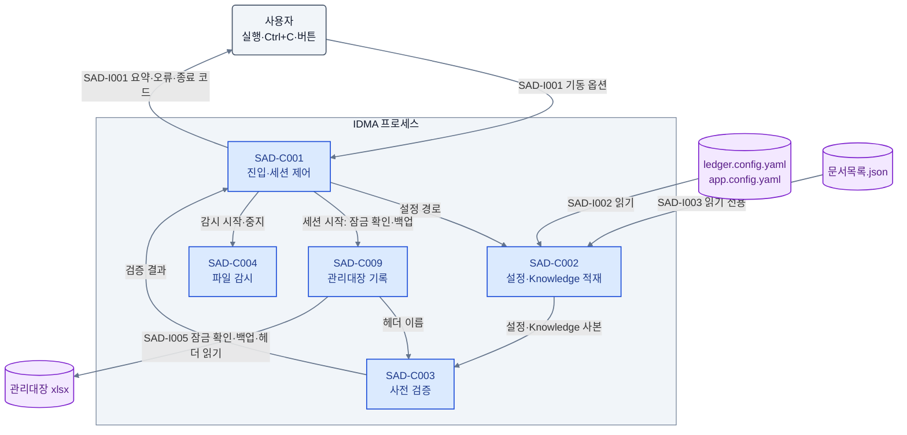
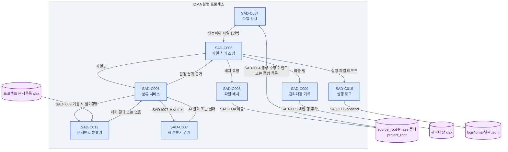
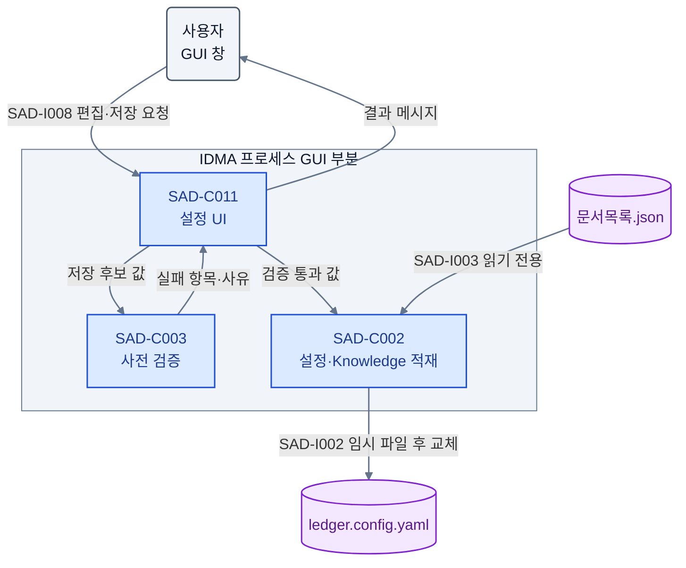
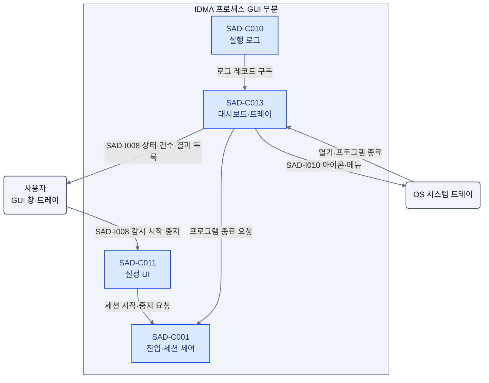

# SAD: IDMA 제출물 관리대장 자동화 시스템
SRS 요구를 현행 `src/app` 패키지 구조 위의 컴포넌트·외부 경계·품질 수단으로 배치한 아키텍처 기술서다.

## 개요
사용자가 실행해 둔 동안 `source_root`를 상주 감시하는 단일 프로세스(GUI 또는 무GUI)의 구조와 되돌리기 어려운 결정 4건을 정의한다.

This SAD is the final design document for IDMA. It describes the architecture structure (views `<SAD-W001>`, `<SAD-W002>`) and the hard-to-reverse decisions `<SAD-R001>`, `<SAD-R003>`, `<SAD-R004>`, `<SAD-R005>`. Implementation below this level is developer judgment within this SAD unless the user explicitly requests otherwise. `docs/3.Design/SDD.md` is not gate-checked; its planned package names (`knowledge/`, `config/`, `scanner.py`, ...) do not exist in the code and are not used here.

- 상태: 초안 (`00.08`), 사용자 합의 근거 없음.
- 범위: the `src/app` Python package — one process per user launch on a local Windows PC, in GUI mode (settings, watch start/stop, dashboard, tray) or `--nogui` mode, that watches `source_root` while running; the files it reads and writes (`ledger.config.yaml`, `app.config.yaml`, `문서목록.json`, the optional project document list xlsx, `source_root`, Phase folders, `project_root`, ledger workbook, `logs/`); and the AI classifier contract boundary.

Inputs: [PRD](../1.Concept/PRD.md) revision `00.03`, [SRS](../2.Requirement/SRS.md) revision `00.08`, and the code under `src/app` as of this revision.

Component placement follows the existing layering of `src/app`: `core/` holds domain types, protocols and use-case logic and imports no adapter; `adapters/` holds file, workbook, log, watcher and AI implementations; `models/` holds the runtime config model and default config files; `ui/` holds the Tkinter window; `main.py` assembles everything. The code was produced before the current SRS (see `docs/notes/LLM작업/완료/Codex 1차 자동빌드 결과물.md`) and deviates from it in several places. Those deviations are listed in `현행 코드 대응` under `<SAD-W001>` as implementation-stage work; this SAD follows the SRS wherever the two differ.

## 이해관계자와 관심사
실무 사용자·Knowledge 관리자·도입 책임자·개발자·유지보수자와 그 관심사를 정의한다.

```
[SAD-S001] 제출물 접수·관리 담당자
Role: user (non-developer practitioners included; launches the program in GUI or `--nogui` mode, starts and stops watching, edits settings)
- 관심사: `<SAD-K001>`, `<SAD-K002>`, `<SAD-K003>`, `<SAD-K004>`, `<SAD-K008>`
```

```
[SAD-S002] Knowledge 관리자
Role: user (edits `문서목록.json` by hand; may be the same person as `<SAD-S001>`)
- 관심사: `<SAD-K005>`
```

```
[SAD-S003] 도입 책임자
Role: acquirer (project owner deciding to replace manual filing and ledger entry)
- 관심사: `<SAD-K001>`, `<SAD-K003>`, `<SAD-K006>`
```

```
[SAD-S004] 개발자
Role: developer
- 관심사: `<SAD-K006>`, `<SAD-K007>`
```

```
[SAD-S005] 유지보수자
Role: maintainer (extends Phases/artifacts and swaps the AI implementation)
- 관심사: `<SAD-K005>`, `<SAD-K007>`
```

```
[SAD-K001] 분류·배치 적합성
Files dropped into `source_root` reach the correct Phase folder by file name alone, with Rule first and AI only for unresolved cases.
```

```
[SAD-K002] 파일 무유실
No run path leaves an input file in zero locations; a failed classification or a system error never deletes or overwrites a file.
```

```
[SAD-K003] 감사 추적성
Every processed file leaves one ledger row and one log record explaining method, evidence, final path and status.
```

```
[SAD-K004] 비개발자 설정 편집
Paths, thresholds and policies are edited and validated in a local GUI without opening YAML.
```

```
[SAD-K005] Knowledge 소유권과 불변성
`문서목록.json` stays under human control; the system never writes it, and edits take effect on the next program start without a sync step.
```

```
[SAD-K006] 실현가능성·위험
The system runs on a local Windows PC with Python 3.11+ and keeps working when no AI implementation is available.
```

```
[SAD-K008] 처리 현황 가시성
While watching runs, the user sees watch state, per-file results and failures without opening log files, and can keep the program in the system tray.
```

```
[SAD-K007] 확장성·유지보수성
New Phases need only config and Knowledge edits; the AI implementation can be replaced without changing callers; path resolution is CWD-independent.
```

## 뷰포인트
런타임 구조 뷰포인트와 GUI 뷰포인트 두 개로 모든 관심사를 커버한다.

```
[SAD-V001] 런타임 구조 뷰포인트
대상 이해관계자: `<SAD-S001>`, `<SAD-S003>`, `<SAD-S004>`, `<SAD-S005>`
대상 관심사: `<SAD-K001>`, `<SAD-K002>`, `<SAD-K003>`, `<SAD-K005>`, `<SAD-K006>`, `<SAD-K007>`
언어/기법: Mermaid flowchart (component-connector), component/interface/quality item lists
출처: self-defined (component-and-connector style)
```

```
[SAD-V002] GUI 뷰포인트
대상 이해관계자: `<SAD-S001>`, `<SAD-S002>`, `<SAD-S005>`
대상 관심사: `<SAD-K004>`, `<SAD-K005>`, `<SAD-K008>`
언어/기법: Mermaid flowchart (component-connector), component/interface item lists
출처: self-defined
```

뷰포인트 선정 근거: the watch-and-process pipeline and the GUI (settings, watch control, dashboard, tray) serve different concerns inside the same process, so the run-time pipeline (`<SAD-V001>`) and the GUI paths (`<SAD-V002>`) are described separately. Every stakeholder `<SAD-S001>`–`<SAD-S005>` and every concern `<SAD-K001>`–`<SAD-K008>` is covered by at least one of them (see `추적성`).

## 뷰
런타임 파이프라인과 GUI 경로를 컴포넌트·외부 경계·품질속성으로 보인다.

### [SAD-W001] 런타임 구조 뷰 (대응: `<SAD-V001>`)
상주 감시 프로세스가 기동 시 설정·Knowledge를 읽고, 감시 세션 동안 안정화된 파일을 감지 순서대로 1건씩 분류·배치·기록하는 구조다. 재실행 없는 즉시 처리를 얻는 대신 세션·안정화·직렬화 규칙이 늘어난다.

대응: `<SAD-V001>`

#### FIG-SAD-001 · 기동과 감시 세션 시작
진입·세션 제어 컴포넌트가 기동 시 사전 검증을 통과한 뒤에만 감시 세션을 열고, 세션 시작 때 관리대장을 점검함을 보인다.



범례: 파랑=컴포넌트, 보라=파일, 회색=사용자. 실선=정보 전달.

Startup order: (1) `<SAD-C002>` loads both config files and Knowledge, and `<SAD-C012>` loads the project document list when `project_doc_info` is set; (2) `<SAD-C003>` checks `<SRS-F004>` items 1–6; any failure exits with code 1 before a window opens or a session starts; (3) GUI mode opens the window in the `Stopped` state, `--nogui` mode starts a session at once. Session start order: (4) `<SAD-C009>` checks the workbook lock (`--nogui`: exit 2; GUI: message, stays `Stopped`); (5) `<SAD-C009>` backs up the workbook; (6) `<SAD-C009>` reads the header row and `<SAD-C003>` checks the 8 header names (missing: session not started; `--nogui` exits 1); (7) `<SAD-C004>` starts watching. No file moves before step 7. Session stop: `<SAD-C004>` stops and drops candidates still waiting for stabilization, then `<SAD-C001>` finishes every stable file already queued before the session ends; `--nogui` prints the summary and exits 0, or 3 when the session had an `Error` file.

#### FIG-SAD-002 · 파일 1건 처리
처리 조정 컴포넌트가 감시·분류·배치·기록 컴포넌트를 순서대로 호출하고 각 외부 저장소와 만나는 지점을 보인다.



범례: 파랑=컴포넌트, 보라=외부 파일·폴더. 실선=정보 전달. 분기 조건과 실패 동작은 아래 경계 정의를 따른다.

#### 컴포넌트
진입·세션 제어부터 문서번호 분류기까지 11개 컴포넌트의 책임과 비책임을 SRS에 연결한다.

```
[SAD-C001] 진입·세션 제어
구현요건: `<SRS-F004>`, `<SRS-F008>`, `<SRS-F009>`, `<SRS-F025>`, `<SRS-F044>`, `<SRS-N008>`
Process entry point and watch-session controller. Parses `[--nogui] [--ledger-config <path>] [--app-config <path>]`, wires core and adapter components, runs the startup checks, opens the GUI or starts a session at once, and maps outcomes to exit codes.
- 책임: CLI parsing (`<SAD-I001>`); dependency assembly; enforcing the startup and session start order above; exit code 1 when `<SAD-C003>` reports a startup failure, before any window or session; when `<SAD-C003>` reports missing ledger headers at a session start, exit code 1 in `--nogui` mode and in GUI mode the cause message with the state staying `Stopped`; starting and stopping sessions on the GUI buttons (`<SAD-C011>`) or at `--nogui` start and Ctrl+C; exit code 2 when `<SAD-C009>` reports the workbook inaccessible at a `--nogui` session start (GUI: message, stays `Stopped`); exit code 3 when a `--nogui` session ended with at least one `Error` file; printing the `--nogui` summary on stop; handing stable files from `<SAD-C004>` to `<SAD-C005>` strictly one at a time; on stop, processing every stable file already queued before ending the session (no loss); stopping the session before exit on window close or tray `프로그램 종료`; every cause message to stderr (stderr only when `project_root` cannot be determined)
- 비책임: file classification (`<SAD-C006>`), per-file orchestration (`<SAD-C005>`), validation rules (`<SAD-C003>`), event detection and stabilization (`<SAD-C004>`)
- 현행 모듈: `src/app/main.py` (`main`, `_build_runtime`, `AppController`)
```

```
[SAD-C002] 설정·Knowledge 적재
구현요건: `<SRS-F001>`, `<SRS-F002>`, `<SRS-F003>`, `<SRS-F005>`, `<SRS-F006>`, `<SRS-F043>`
Loads `ledger.config.yaml` and `app.config.yaml` (`watch` keys only) into the runtime config model and `문서목록.json` into an in-memory Knowledge copy once at program start, and owns the single path-resolution rule.
- 책임: YAML/JSON parsing into immutable models; resolving every relative path against `project_root` (and a relative `project_root` against the config file directory); writing `ledger.config.yaml` only on behalf of `<SAD-C011>` after validation, by writing a temporary file and then replacing the original, preserving keys outside the 8 required ones; exposing all thresholds, policies, Phases and artifacts from files rather than code constants
- 비책임: validating values (`<SAD-C003>`); any write, rename or delete of `문서목록.json` (no such operation exists); caching Knowledge outside the process
- 현행 모듈: `src/app/adapters/config_loader.py`, `src/app/models/config_schema.py`
```

```
[SAD-C003] 사전 검증
구현요건: `<SRS-F004>`, `<SRS-F042>`
Owns the configuration and Knowledge validation rule set used at startup, at session start and before a UI save.
- 책임: the 6 ordered startup checks of `<SRS-F004>` (config keys, Knowledge schema and abbr uniqueness, Phase key set equality, path existence/access, value ranges, watch values and `project_doc_info` completeness/existence) plus the ledger header check of SRS §8.4 on header names supplied by `<SAD-C009>` (session start step 6); the save-time checks of `<SRS-F042>`; returning every failed item with its cause
- 비책임: deciding exit codes or showing messages (`<SAD-C001>`, `<SAD-C011>`); loading config and Knowledge (`<SAD-C002>`); opening the workbook (`<SAD-C009>`)
- 현행 모듈: `src/app/core/validation.py`
```

```
[SAD-C004] 파일 감시
구현요건: `<SRS-F007>`, `<SRS-F008>`, `<SRS-F009>`
Watches `source_root` during a session and emits stable target files.
- 책임: watchdog create/modify events on direct files when the library is available, otherwise re-reading the direct file list every `watch.scan_interval_seconds`; no recursion; excluding directories, symlinks, names starting with `.` or `~$`, and 0-byte files; emitting a candidate only after its size and modification time stayed unchanged for `watch.file_stable_seconds` (checked every 0.5 s); emitting the same (absolute path, size, mtime) at most once per program run (the record survives session restarts); dropping waiting candidates on stop; emitting in detection order
- 비책임: deciding when sessions start or stop (`<SAD-C001>`); serializing processing (`<SAD-C001>`); classification or movement (`<SAD-C006>`, `<SAD-C008>`)
- 현행 모듈: `src/app/adapters/file_watcher.py` (`StableFileWatcher`)
```

```
[SAD-C005] 파일 처리 조정
구현요건: `<SRS-F008>`, `<SRS-F022>`, `<SRS-F023>`, `<SRS-F025>`, `<SRS-F026>`, `<SRS-F031>`, `<SRS-F032>`
Use case that drives one file through classify -> place -> ledger -> log and owns the per-file state.
- 책임: sequential processing where one file's exception becomes that file's `Error` and processing continues; the state paths of `<SRS-F026>`; choosing Phase folder, `project_root` (Fallback) or leave-in-place (`fallback.enabled=false`, `Error`); building the final ledger row (`classification_method` domain, `ai_confidence` only for `AI`, empty `phase`/`artifact_abbr` for Fallback); writing `Filed` only after a successful move; when the ledger row write fails after a move, asking `<SAD-C008>` to move the file back to its `source_root` path and recording `Error` in the file log record only (`<SRS-F025>`)
- 비책임: matching rules (`<SAD-C006>`), filesystem operations (`<SAD-C008>`), workbook I/O (`<SAD-C009>`), log formatting (`<SAD-C010>`)
- 현행 모듈: `src/app/core/usecases.py` (types in `src/app/core/entities.py`)
```

```
[SAD-C006] 분류 서비스
구현요건: `<SRS-F010>`, `<SRS-F011>`, `<SRS-F012>`, `<SRS-F013>`, `<SRS-F014>`, `<SRS-F016>`, `<SRS-F018>`, `<SRS-F035>`
Deterministic Rule Engine plus the gate that decides whether to call AI and whether to adopt its answer.
- 책임: asking `<SAD-C012>` first when `project_doc_info` is set and, on a resolved match, returning `Rule-ABBR` with confidence 1.0 and its evidence without abbr, full_name or AI steps; tokenization of `<SRS-F010>`; abbr exact match (Rule Engine priority 1, confidence 1.0); full_name word ratio with the 0.8/0.6 grades and min-ratio filter; tie handling; the 3 AI call conditions of `<SRS-F014>`; the 4 adoption conditions of `<SRS-F016>`; producing the method, confidence and `match_evidence` for every outcome
- 비책임: AI implementation details (`<SAD-C007>`); document-number lookup (`<SAD-C012>`); file placement (`<SAD-C008>`); reading Knowledge from disk (`<SAD-C002>`)
- 현행 모듈: `src/app/core/rule_engine.py`
```

```
[SAD-C007] AI 분류기 경계
구현요건: `<SRS-F015>`, `<SRS-F017>`
Single abstract AI classifier contract and its pluggable implementation.
- 책임: exposing only `classify(filename, artifacts) -> AIResult | None` (`<SAD-I007>`); passing the file name only, never file content; turning an exception, `None` or a response slower than 30 s into an AI failure for that file only
- 비책임: deciding when to call or whether to adopt (`<SAD-C006>`); Fallback placement (`<SAD-C005>`)
- 현행 모듈: protocol `AIClassifier` in `src/app/core/entities.py`; implementation `StubAIClassifier` in `src/app/adapters/ai_client.py` (always returns `None`)
```

```
[SAD-C008] 파일 배치
구현요건: `<SRS-F020>`, `<SRS-F021>`, `<SRS-F022>`, `<SRS-F024>`
Moves one file to its decided directory without overwriting or losing it.
- 책임: creating the target directory; move (not copy) keeping the original name; `_<n>` duplicate suffix from `duplicate.suffix_start` up to `suffix_start + 999`; leaving no partial copy and keeping the original in `source_root` on any move failure; moving a file back to its original `source_root` path on request from `<SAD-C005>`; returning the final absolute path or the failure cause
- 비책임: choosing the target directory (`<SAD-C005>`); ledger or log writes (`<SAD-C009>`, `<SAD-C010>`)
- 현행 모듈: `src/app/adapters/file_ops.py`
```

```
[SAD-C009] 관리대장 기록
구현요건: `<SRS-F030>`, `<SRS-F033>`
Appends final result rows to the existing ledger workbook.
- 책임: at session start, checking the exclusive lock, then backing up the workbook to `project_root/backup/<name>_<run_id>.xlsx` before opening it, then reading the header row for `<SAD-C003>`; a lock at session start is reported before any file moves (`<SAD-C001>` decides exit 2 or `Stopped`); locating the 8 columns by header name; appending rows below the last data row without changing existing rows, sheets, formulas or formats; loading the workbook once per session and saving after each appended row; when a save fails, discarding the in-memory workbook and reloading it from disk before the next row, so the failed row never reaches a later save and the file holds only rows of successfully saved files
- 비책임: deciding row values (`<SAD-C005>`); creating or repairing headers or sheets (a missing header blocks the session start in `<SAD-C003>`)
- 현행 모듈: `src/app/adapters/excel_repo.py`
```

```
[SAD-C010] 실행 로그
구현요건: `<SRS-F034>`, `<SRS-F035>`, `<SRS-F036>`
Writes run-level and file-level JSON Lines records.
- 책임: one `type: "run"` record per session and one `type: "file"` record per processed file under the session `run_id`, with the fields of SRS §8.5 including `match_evidence` and `is_fallback`; session start and stop records; appending to `project_root/logs/idma-<YYYYMMDD>.jsonl` (UTF-8, `\n`); creating `logs/`; publishing each record to in-process subscribers (`<SAD-C013>`) so that a subscriber failure never stops logging; turning a log write failure into a stderr warning without stopping processing
- 비책임: building the evidence content (`<SAD-C006>`); ledger rows (`<SAD-C009>`)
- 현행 모듈: `src/app/adapters/logger.py`
```

```
[SAD-C012] 문서번호 분류기
구현요건: `<SRS-F018>`
Optional adapter that resolves a file to an artifact through the project document list xlsx.
- 책임: when all 4 `project_doc_info` keys are set, reading the sheet once at program start, read-only, through `<SAD-I009>`; keeping rows whose document number and 문서구분 cells are both non-empty; normalizing to uppercase ASCII letters and digits; finding the first mapping, longest document number first, whose number is contained in the normalized file name; resolving 문서구분 to a Knowledge `abbr` (exact normalized match, else the longest contained `abbr`); returning artifact, Phase and evidence (document number, 문서구분 value, abbr) or no result; zero mappings when the sheet or a header is missing
- 비책임: deciding precedence and the final method label (`<SAD-C006>`); validating `project_doc_info` completeness and file existence (`<SAD-C003>`); any write to the xlsx (none exists)
- 현행 모듈: `src/app/adapters/project_doc_classifier.py` (`ProjectDocumentClassifier`)
```

#### 외부 인터페이스
명령행·설정·Knowledge·파일시스템·워크북·로그·AI 경계의 형식과 실패 동작을 정의한다.

```
[SAD-I001] 명령행 경계
구현요건: `<SRS-F004>`, `<SRS-F025>`, `<SRS-F033>`, `<SRS-F044>`, `<SRS-N008>`
`<program> [--nogui] [--ledger-config <path>] [--app-config <path>]` (SRS §8.1); `<program>` is the packaged executable or `python -m app.main`
- 입력: no option = GUI mode; `--nogui` = start a session at once and run until Ctrl+C; config paths default to the same-named files in the program's bundled `models` folder; a found config file is never a path base, `project_root` is
- 출력: `--nogui` stop prints a summary (target count, count per method, `Error` count) to stdout; GUI mode reports through the window
- 실패 시 동작: exit 0 = normal stop; 1 = startup validation or config failure (including a missing or unparseable `app.config.yaml`), before any window, session or move, or missing ledger headers at a `--nogui` session start; 2 = ledger workbook locked or not accessible at a `--nogui` session start, before any move; 3 = a `--nogui` session ended with at least one `Error` file. Every non-zero exit writes a cause message to stderr and the log, except when `project_root` cannot be determined (`ledger.config.yaml` missing, unparseable or `project_root` key missing): stderr only (`<SRS-F004>`, `<SRS-N008>`)
```

```
[SAD-I002] Runtime Config 파일 경계
구현요건: `<SRS-F002>`, `<SRS-F003>`, `<SRS-F006>`, `<SRS-F009>`, `<SRS-F043>`
`ledger.config.yaml`, YAML, schema of SRS §8.2 (8 required keys, optional `config_version`, `workbook.sheet`, `project_doc_info` group); `app.config.yaml`, YAML, SRS §8.2.1 (`watch.scan_interval_seconds`, `watch.file_stable_seconds`, other keys ignored)
- 입력: both read once at program start by `<SAD-C002>`; `ledger.config.yaml` written only by the UI save path; `app.config.yaml` never written
- 출력: on save, a temporary file is written and then swapped in; keys outside the schema are preserved
- 실패 시 동작: a missing or unparseable `ledger.config.yaml` or `app.config.yaml` blocks startup (exit 1, `<SRS-F004>` items 1 and 6); a failed save leaves the previous file intact and reports the cause in the UI; saved values apply after the next program start
```

```
[SAD-I003] Knowledge 파일 경계
구현요건: `<SRS-F001>`, `<SRS-F005>`, `<SRS-N006>`
`문서목록.json`, JSON, `artifacts[]` of `{abbr, full_name, phase}` (SRS §8.3), resolved against `project_root`
- 입력: read-only, once at program start and on UI display
- 출력: none; the system has no write path to this file
- 실패 시 동작: missing file, parse error, empty field or duplicate `abbr` blocks startup (exit 1)
```

```
[SAD-I004] 파일시스템 배치 경계
구현요건: `<SRS-F007>`, `<SRS-F020>`, `<SRS-F021>`, `<SRS-F022>`, `<SRS-F023>`, `<SRS-F024>`
Local or network/OneDrive-synced directories: `source_root` (read, move-out), Phase folders and `project_root` (move-in)
- 입력: direct regular files of `source_root`, detected by create/modify events or by periodic re-reading
- 출력: each file in exactly one of Phase folder, `project_root`, or `source_root`
- 실패 시 동작: permission, disk-space or path-length failure keeps the original in `source_root`, removes any partial target and marks the file `Error`; suffix exhaustion marks the file `Error`; other files continue
```

```
[SAD-I005] 관리대장 워크북 경계
구현요건: `<SRS-F025>`, `<SRS-F030>`, `<SRS-F033>`
xlsx workbook at `workbook.path`, target sheet `workbook.sheet` (default `관리대장`), 8 header-named columns (SRS §8.4)
- 입력: existing workbook with the 8 headers present; access order: lock check, backup, header read, row appends
- 출력: backup copy under `project_root/backup`; appended rows with final states only (`Ready`, `Filed`, `Error`)
- 실패 시 동작: exclusive lock at session start -> session not started (`--nogui`: exit 2; GUI: `Stopped`) with a "close the ledger and start again" message, no file moved; a lock during a session is a per-row write failure; missing headers at session start -> session not started (`--nogui`: exit 1; GUI: `Stopped` with the cause shown) via `<SAD-C003>`; a per-row write failure moves that file back to `source_root`, marks it `Error`, records the result in the log only and leaves no row for it in the workbook (`<SAD-C009>` reloads after a failed save) (`<SRS-F025>`)
```

```
[SAD-I006] 로그 파일 경계
구현요건: `<SRS-F034>`, `<SRS-F036>`
`project_root/logs/idma-<YYYYMMDD>.jsonl`, JSON Lines, append-only, schema of SRS §8.5
- 입력: run and file records from `<SAD-C010>`
- 출력: one JSON object per line
- 실패 시 동작: write failure prints a stderr warning; processing continues
```

```
[SAD-I007] AI 분류기 계약
구현요건: `<SRS-F015>`, `<SRS-F017>`
`classify(filename: str, artifacts: list[Artifact]) -> AIResult | None` (SRS §8.6); the implementation may be local or remote and is not visible to callers
- 입력: original file name with extension; Knowledge artifact list
- 출력: `artifact_abbr`, `phase`, `ai_confidence` in [0.0, 1.0]
- 실패 시 동작: exception, `None` or > 30 s -> AI failure for that file, then Fallback; never stops the session or other files
```

```
[SAD-I009] 프로젝트 문서목록 xlsx 경계
구현요건: `<SRS-F018>`
xlsx at `project_doc_info.path` (resolved against `project_root`), sheet `project_doc_info.sheet_name`, header row 1 with the `column_title_doc_no` and `column_title_abbr` columns
- 입력: read-only, once at program start, only when all 4 `project_doc_info` keys are set
- 출력: none; the system never writes this file
- 실패 시 동작: missing file blocks startup through `<SRS-F004>` item 6 (exit 1); a missing sheet or header yields zero mappings and classification continues with `<SAD-C006>` Rule steps
```

#### 품질속성
SRS 비기능 요구 8건을 구조적 수단과 확인 방법에 연결한다.

```
[SAD-Q001] 경로 해석 결정성
구현요건: `<SRS-N001>`, `<SRS-F003>`
Identical ledger rows (6 columns) across 3 different CWDs.
- 구조적 수단: `<SAD-C002>` is the only path resolver and its base is `project_root`; no other component builds paths from the CWD
- 확인 방법: regression test running the same inputs from 3 CWDs and comparing rows
```

```
[SAD-Q002] 설정 확장성
구현요건: `<SRS-N002>`, `<SRS-F006>`
A new Phase works with config and Knowledge edits only.
- 구조적 수단: Phases, artifacts, paths and thresholds reach `<SAD-C006>`/`<SAD-C005>` only through `<SAD-C002>` models (`<SAD-R001>`); code keeps only the confidence grades
- 확인 방법: regression test adding one Phase to config and Knowledge and checking placement
```

```
[SAD-Q003] AI 의존도 최소화
구현요건: `<SRS-N003>`, `<SRS-F014>`
Zero AI calls for files outside the 3 call conditions; Rule placement works without an AI implementation.
- 구조적 수단: the call gate lives in `<SAD-C006>` before `<SAD-I007>`; `<SAD-C007>` failure degrades to Fallback (`<SAD-R004>`)
- 확인 방법: regression test with ≥ 10 abbr-named files counting AI interface calls = 0, and a run with a failing AI implementation
```

```
[SAD-Q004] 파일 무유실
구현요건: `<SRS-N004>`, `<SRS-F024>`
Every target file exists in exactly one of 3 locations after the run.
- 구조적 수단: `<SAD-C008>` moves only after all decisions are final and never leaves partial copies; `<SAD-C005>` writes `Filed` only after a successful move; `<SAD-C009>` lock detection happens before any move; a ledger write failure moves the file back to `source_root`
- 확인 방법: regression test for normal, Rule failure, AI failure and move exception scenarios comparing file counts and content hashes before and after
```

```
[SAD-Q005] 감사 추적성
구현요건: `<SRS-N005>`, `<SRS-F030>`, `<SRS-F034>`
Ledger row count = log file-record count = target count, each with method and evidence; files whose ledger row write failed are excluded from the ledger count, have no ledger row (reload after failed save in `<SAD-C009>`) and appear as `Error` file records in the log (`<SRS-N005>`).
- 구조적 수단: `<SAD-C005>` emits exactly one final row to `<SAD-C009>` and one file record to `<SAD-C010>` per target, both carrying `<SAD-C006>` evidence
- 확인 방법: regression test comparing counts and checking `classification_method`/`match_evidence` presence
```

```
[SAD-Q006] Knowledge 불변성
구현요건: `<SRS-N006>`, `<SRS-F001>`, `<SRS-F041>`
`문서목록.json` hash, mtime and permissions unchanged by processing and UI.
- 구조적 수단: `<SAD-C002>` offers no Knowledge write operation and `<SAD-C011>` has no Knowledge edit control (`<SAD-R001>`)
- 확인 방법: regression test comparing SHA-256 and mtime around a full watch session and a UI save
```

```
[SAD-Q007] 처리 성능
구현요건: `<SRS-N007>`
≤ 1 s per file excluding stabilization wait and AI; 100 files processed back to back in ≤ 60 s with 200 artifacts, excluding stabilization wait and AI, on local disk.
- 구조적 수단: Knowledge, config and the document list load once at program start (`<SAD-C002>`, `<SAD-C012>`); the workbook is loaded once per session by `<SAD-C009>` (saved after each row) rather than reopened per row; Rule matching is in-memory
- 확인 방법: timed session with a 200-artifact Knowledge, 100 input files and a stub AI, measuring from stable emission to ledger save
```

```
[SAD-Q008] 오류 보고 완결성
구현요건: `<SRS-N008>`, `<SRS-F025>`
Every non-zero exit and every `Error` file has a cause message in stderr and the log; a run where `project_root` cannot be determined reports to stderr only.
- 구조적 수단: `<SAD-C001>` converts all run-level exceptions into exit codes with messages; `<SAD-C005>` records exception type and message in `error_message` and the file log record
- 확인 방법: `--nogui` tests per exit code 1/2/3 checking stderr and log contain a cause message, not only a traceback; for a missing `ledger.config.yaml`, an unparseable `ledger.config.yaml` and a missing `project_root` key, checking stderr only; for a missing or unparseable `app.config.yaml` (`project_root` already known), checking that stderr and the log both contain the cause message
```

#### 현행 코드 대응
SRS와 다른 현행 코드와 SRS 밖 현행 코드를 impl 단계 작업으로 기록한다.

The table records deviations of `src/app` from this SAD observed in the design review. It is not exhaustive: impl-stage work is scoped by the SRS and this SAD, not by this table alone. Deviations are implementation-stage work, not design alternatives.

| SAD 항목 | 현행 코드 | SRS 대비 차이 |
|---|---|---|
| `<SAD-C001>` | `main.py` | `--knowledge` option overrides the Knowledge path (SRS: `project_root`-based `문서목록.json`) and its default name is `문서 목록.json` (with a space); the session-start header check compares the configured ledger columns, not the 8 columns of SRS §8.4 (see `<SAD-C009>`) |
| `<SAD-C002>` | `config_loader.py`, `config_schema.py` | Knowledge read as nested `phases[].artifacts[]`, not SRS §8.3 `artifacts[]`; missing keys get defaults (e.g. `ai.confidence_threshold` 0.8) instead of blocking; a relative `project_root` resolves against the CWD, not the config file directory; `source_root` is used as given without `project_root` resolution; `workbook.sheet` is ignored and the sheet name comes from `ledgers.submission.sheet_name` (default `제출물 관리대장`); save writes a fixed key set by direct overwrite; a missing or unparseable `app.config.yaml` raises an unhandled exception (traceback, no cause message in the log) instead of the `<SRS-F004>` item 6 block |
| `<SAD-C003>` | `core/validation.py` | `full_name_min_ratio` accepts 0.0; requires `source_root` to be absolute; no config key completeness, abbr uniqueness, access-right or ledger header check; requires Phase folders to exist (SRS creates them) |
| `<SAD-C004>` | `adapters/file_watcher.py` | no exclusion of names starting with `.`/`~$`, 0-byte files or symlinks; in watchdog mode each event starts its own thread, so stable files are emitted in stabilization-completion order, not detection order (`<SRS-F008>` "detection order"; processing itself is serialized by `<SAD-C001>`); `watch.use_fs_events` in `app.config.yaml` is not read (watchdog is used whenever importable) |
| `<SAD-C005>` | `core/usecases.py` | `fallback.enabled=false` raises and yields `Error` instead of `Ready`; Fallback rows store `phase`/`artifact_abbr` = `Fallback`; `Error` rows are not appended to the ledger |
| `<SAD-C006>` | `core/rule_engine.py` | tokenizer splits on every non-ASCII-alphanumeric character instead of the `<SRS-F010>` delimiter set; 2+ abbr matches continue to full_name matching instead of going to AI; condition 3 of `<SRS-F014>` (Rule-FULL below AI threshold) not applied; adoption conditions 2–3 of `<SRS-F016>` not checked; no `match_evidence` (only a `reason` string) |
| `<SAD-C007>` | `core/entities.py`, `ai_client.py` | contract is `classify(filename, knowledge)`, not SRS §8.6 `classify(filename, artifacts)`; stub only; 30 s timeout not enforced; an AI exception is not caught and ends the file as `Error` instead of Fallback |
| `<SAD-C008>` | `adapters/file_ops.py` | copies (`shutil.copy2`), original stays in `source_root`; no suffix upper bound |
| `<SAD-C009>` | `adapters/excel_repo.py` | row append creates the workbook, sheet and missing headers (changes structure); a locked workbook during row append is handled by 3 retries then an exception; columns differ from SRS §8.4 (`제출물명`, `제출물 형태`, `접수일` + `processed_at`, no `original_filename`), so the session-start header check (implemented) validates the configured columns instead of the 8 SRS columns; opens and saves the workbook for every row |
| `<SAD-C010>` | `adapters/logger.py` | file name `submission_automation_<YYYYMMDD>.jsonl`; event records without `run_id`, `type` or `match_evidence`; write failure is not caught |
| `<SAD-C011>` | `ui/settings_window.py` | saves by direct overwrite; no `<SRS-F042>` validation before save; no folder picker; no add/delete of `roots.phase_folders` rows; `workbook_path` is editable (SRS §8.7: not editable); the `실행` tab shows `scan_interval_seconds`/`file_stable_seconds` fields whose values are neither saved nor applied to the running watcher |
| none | `core/phase_resolver.py`, `core/logic.py`, `utils/helpers.py`, `adapters/adapter_example.py`, `models/model_example.py` | unused or template sample code; no SRS counterpart |
| none | `models/app.config.yaml` | `watch.use_fs_events` and `performance.cpu_target_percent` are present but not read by code; not in the SRS |

Resident watching, project document-number matching, the dashboard and the tray became SRS requirements by user decision DISC-007 Q02 (2026-10-10) and are architected as `<SAD-C004>`, `<SAD-C012>`, `<SAD-C013>`. Other code without an SRS counterpart still requires an SRS change before it is kept (`AGENTS.md` rule 3).

### [SAD-W002] GUI 뷰 (대응: `<SAD-V002>`)
로컬 GUI가 Runtime Config만 검증 후 원자적으로 저장하고, 감시 세션을 제어하며, 로그 레코드로 처리 현황을 보여주는 구조다. 편집 편의 대신 Knowledge 편집 기능을 의도적으로 빼고, 현황은 로그 구독으로만 얻어 처리 경로와 분리한다.

대응: `<SAD-V002>`

#### FIG-SAD-003 · 설정 편집 경로
UI가 검증을 거쳐 설정 파일에만 쓰고 Knowledge 파일은 읽기만 함을 보인다.



범례: 파랑=컴포넌트, 보라=파일, 회색=사용자. 실선=정보 전달.

#### FIG-SAD-004 · 감시 제어·대시보드·트레이
GUI 버튼이 세션 제어로 가고, 대시보드는 로그 레코드 구독으로만 현황을 받으며, 트레이는 창 표시만 바꿈을 보인다.



범례: 파랑=컴포넌트, 회색=사용자·OS. 실선=정보 전달.

#### 컴포넌트
설정 UI와 대시보드·트레이 컴포넌트를 정의하고 공유 컴포넌트 `<SAD-C001>`, `<SAD-C002>`, `<SAD-C003>`, `<SAD-C010>`은 런타임 구조 뷰 정의를 따른다.

```
[SAD-C011] 설정 UI
구현요건: `<SRS-F040>`, `<SRS-F041>`, `<SRS-F042>`, `<SRS-F043>`, `<SRS-F044>`
Settings tabs and common buttons of the GUI-mode Tkinter window; edits Runtime Config only.
- 책임: view/edit of the 11 items of `<SRS-F040>` (`workbook.path` is not editable, SRS §8.7) (path fields with direct input and folder picker; Phase mapping table with add/delete/edit; the 4 `project_doc_info` fields); calling `<SAD-C003>` before save and showing each failed item; delegating the save to `<SAD-C002>`; `감시 시작`/`감시 중지` buttons forwarded to `<SAD-C001>`; optional read-only display of Knowledge
- 비책임: any Knowledge edit control or write; session control logic (`<SAD-C001>`); validation rules (`<SAD-C003>`); file format and atomic replace (`<SAD-C002>`); processing status display (`<SAD-C013>`)
- 현행 모듈: `src/app/ui/settings_window.py` (path, classification tabs and footer buttons)
```

```
[SAD-C013] 대시보드·트레이
구현요건: `<SRS-F044>`, `<SRS-F045>`, `<SRS-F046>`
Dashboard tab and tray handling of the GUI-mode window.
- 책임: subscribing to `<SAD-C010>` records; showing `Running`/`Stopped`, last processed time, success and failure counts since program start, the per-file summary list (file name, placement folder, time, `성공`/`실패`, at most 500 rows, oldest removed first) and the event detail of the selected file, with failures and `ERROR` events in red; `로그 복사` of the summary lines `[time] [result] file | folder` to the clipboard; `트레이로 최소화` hiding the window behind a tray icon whose menu offers `열기` (default) and `프로그램 종료`; an error dialog and no hiding when the tray libraries cannot be loaded
- 비책임: writing files, ledger or settings (display only); session state changes except forwarding `프로그램 종료` to `<SAD-C001>`; building log records (`<SAD-C010>`)
- 현행 모듈: `src/app/ui/settings_window.py` (dashboard tab, tray methods)
```

#### 외부 인터페이스
사용자가 보는 GUI 창과 시스템 트레이 경계를 정의한다.

```
[SAD-I008] GUI 창 경계
구현요건: `<SRS-F040>`, `<SRS-F041>`, `<SRS-F042>`, `<SRS-F044>`, `<SRS-F045>`
Local GUI window (SRS §8.7); no web server or remote access
- 입력: values for the 11 editable items and `설정 저장`; `감시 시작`/`감시 중지`; dashboard list selection, `로그 복사`, `트레이로 최소화`; window close
- 출력: save result message; watch state, counts, result list and event detail; clipboard text
- 실패 시 동작: validation failure shows each failed item and reason and writes nothing; a write failure leaves the previous config intact and shows the cause; a session start failure shows the cause and keeps `Stopped`
```

```
[SAD-I010] 시스템 트레이 경계
구현요건: `<SRS-F046>`
OS system tray icon and menu through the tray libraries (`pystray`, Pillow)
- 입력: menu choice `열기` (default action) or `프로그램 종료`
- 출력: tray icon while the window is hidden
- 실패 시 동작: when the libraries cannot be loaded, an error dialog shows the cause and the window stays visible; watch state is unchanged
```

## 뷰 간 일관성
두 뷰는 `<SAD-C001>`, `<SAD-C002>`, `<SAD-C003>`, `<SAD-C010>`을 공유하며 알려진 불일치 2건을 기록한다.

```
[SAD-X001] 런타임 구조 뷰·설정 편집 뷰 검증 범위 차이
`<SAD-C003>` applies the 6-item startup set of `<SRS-F004>` plus the SRS §8.4 header check in `<SAD-W001>`, but the save-time set of `<SRS-F042>` in `<SAD-W002>`. Both sets require `project_root` and `source_root` themselves and the parent of `workbook.path` to exist (SRS `00.02` clarification of `<SRS-F004>` item 4, retained in `00.06`). The save-time set does not check config key completeness, Knowledge schema details, abbr uniqueness, read/write access rights, watch values, the document list file or the ledger headers.
- 영향: a config the UI accepts can still be blocked at the next program start (exit 1).
- 해소 계획: intentionally kept; both rule sets come from the SRS and the startup check remains the final safeguard. Aligning them needs an SRS change.
```

```
[SAD-X002] 저장된 설정과 실행 중 설정의 시점 차이
In `<SAD-W002>` a successful save writes `ledger.config.yaml` at once, but `<SAD-W001>` keeps the configuration and Knowledge loaded at program start for every later session until the program restarts (`<SRS-F043>`, `<SRS-F005>`).
- 영향: pressing `감시 시작` after a save still runs with the startup values; the user can believe a saved change is active.
- 해소 계획: intentionally kept; both behaviors come from the SRS. Applying saved values without restart needs an SRS change.
```

## 아키텍처 근거
되돌리기 어려운 결정 4건만 근거·되돌림 비용과 함께 기록한다. 1회 실행 결정은 사용자 결정으로 상주 감시 결정으로 대체됐다.

The structure keeps the existing `core/` (domain logic and protocols, no adapter imports) versus `adapters/` (file, workbook, log, AI implementations) split of `src/app`. That split lets the Rule Engine stay deterministic and lets the AI implementation, workbook library or log format change without touching `core/`. Component internals, library choices and test layout are developer judgment.

All four decisions restate constraints already fixed by SRS revision `00.08` (§2, §5.2, §5.3, §8.1–§8.6, §9); none adds a requirement. The former one-shot run decision (SAD-R002, ADR-002) was withdrawn in this SAD revision `00.04` after user decision DISC-007 Q02; ADR-002 is marked superseded by ADR-005.

```
[SAD-R001] Knowledge와 Runtime Config를 두 파일로 분리하고 Knowledge는 읽기 전용
구현요건: `<SRS-F001>`, `<SRS-F002>`, `<SRS-F005>`, `<SRS-F006>`, `<SRS-N002>`, `<SRS-N006>`
- 결정: classification knowledge lives only in human-maintained `문서목록.json` (read-only to the system); operational settings live only in `ledger.config.yaml` (editable through the UI); no cache, database or code copy of either.
- 근거: separates the user-owned reference data from tunable settings so that neither processing nor the UI can corrupt Knowledge, and Phase additions need no code change.
- 되돌림 비용: 높음 — merging or making Knowledge writable changes both user-facing file contracts, the UI scope and the immutability tests; existing project folders' files must be migrated.
- 참조: ADR-001
- 영향 범위: `<SAD-C002>`, `<SAD-C003>`, `<SAD-C011>`, `<SAD-I002>`, `<SAD-I003>`
```

```
[SAD-R003] 관리대장은 기존 xlsx 워크북에 행만 추가
구현요건: `<SRS-F030>`, `<SRS-F033>`
- 결정: the ledger of record is the user's existing xlsx workbook; the system backs it up, then only appends rows under 8 header-named columns, never altering existing rows, sheets, formulas or formats; there is no separate system database.
- 근거: the ledger is a shared business artifact that people already open and edit in Excel; append-only plus backup keeps their structure and makes every run recoverable.
- 되돌림 비용: 높음 — moving to a database or a system-owned file changes the user's deliverable, the lock/exit-2 contract and every audit query built on the workbook.
- 참조: ADR-003
- 영향 범위: `<SAD-C009>`, `<SAD-I005>`, `<SAD-C005>`
```

```
[SAD-R004] Rule 우선, AI는 단일 추상 계약 뒤의 보조 분류
구현요건: `<SRS-F014>`, `<SRS-F015>`, `<SRS-F017>`, `<SRS-N003>`
- 결정: the deterministic Rule Engine decides first; AI is called only under the 3 conditions of `<SRS-F014>`, only through the single `classify` contract, and any AI failure degrades to Fallback.
- 근거: keeps results reproducible and auditable, keeps the system usable without any AI implementation, and keeps vendor choice out of callers.
- 되돌림 비용: 높음 — making AI primary or exposing vendor APIs changes the meaning of `classification_method` and `match_evidence` in every ledger row and log, breaks determinism tests and couples core logic to one vendor.
- 참조: ADR-004
- 영향 범위: `<SAD-C006>`, `<SAD-C007>`, `<SAD-I007>`
```

```
[SAD-R005] 사용자가 실행해 둔 동안 source_root를 상주 감시하는 단일 프로세스
구현요건: `<SRS-F004>`, `<SRS-F008>`, `<SRS-F009>`, `<SRS-F044>`
- 결정: one process per user launch, GUI mode by default or `--nogui`, validates once at startup and processes files during watch sessions (watchdog events, else polling) after stabilization, one file at a time; there is no one-shot run command, OS service or scheduler registration.
- 근거: user decision DISC-007 Q02 (2026-10-10) documents the operating model the code already uses; dropped files are processed without re-running, and the GUI can show progress and stay in the tray.
- 되돌림 비용: 높음 — returning to a one-shot run changes the CLI and exit-code contract, the session and `run_id` model, backup and lock timing, the dashboard and tray, and the user's operating procedure.
- 참조: ADR-005
- 영향 범위: `<SAD-C001>`, `<SAD-C004>`, `<SAD-C009>`, `<SAD-C010>`, `<SAD-C013>`, `<SAD-I001>`
```

## 추적성
SRS 요구 47건과 이해관계자·관심사가 SAD 항목에 모두 연결됨을 보인다.

| SRS 요구사항 | SAD 항목 |
|---|---|
| `<SRS-F001>` | `<SAD-C002>`, `<SAD-I003>`, `<SAD-Q006>`, `<SAD-R001>` |
| `<SRS-F002>` | `<SAD-C002>`, `<SAD-I002>`, `<SAD-R001>` |
| `<SRS-F003>` | `<SAD-C002>`, `<SAD-I002>`, `<SAD-Q001>` |
| `<SRS-F004>` | `<SAD-C001>`, `<SAD-C003>`, `<SAD-I001>`, `<SAD-R005>` |
| `<SRS-F005>` | `<SAD-C002>`, `<SAD-I003>`, `<SAD-R001>` |
| `<SRS-F006>` | `<SAD-C002>`, `<SAD-I002>`, `<SAD-Q002>`, `<SAD-R001>` |
| `<SRS-F007>` | `<SAD-C004>`, `<SAD-I004>` |
| `<SRS-F008>` | `<SAD-C001>`, `<SAD-C004>`, `<SAD-C005>`, `<SAD-R005>` |
| `<SRS-F009>` | `<SAD-C001>`, `<SAD-C004>`, `<SAD-I002>`, `<SAD-R005>` |
| `<SRS-F010>` | `<SAD-C006>` |
| `<SRS-F011>` | `<SAD-C006>` |
| `<SRS-F012>` | `<SAD-C006>` |
| `<SRS-F013>` | `<SAD-C006>` |
| `<SRS-F014>` | `<SAD-C006>`, `<SAD-Q003>`, `<SAD-R004>` |
| `<SRS-F015>` | `<SAD-C007>`, `<SAD-I007>`, `<SAD-R004>` |
| `<SRS-F016>` | `<SAD-C006>` |
| `<SRS-F017>` | `<SAD-C007>`, `<SAD-I007>`, `<SAD-R004>` |
| `<SRS-F018>` | `<SAD-C006>`, `<SAD-C012>`, `<SAD-I009>` |
| `<SRS-F020>` | `<SAD-C008>`, `<SAD-I004>` |
| `<SRS-F021>` | `<SAD-C008>`, `<SAD-I004>` |
| `<SRS-F022>` | `<SAD-C005>`, `<SAD-C008>`, `<SAD-I004>` |
| `<SRS-F023>` | `<SAD-C005>`, `<SAD-I004>` |
| `<SRS-F024>` | `<SAD-C008>`, `<SAD-I004>`, `<SAD-Q004>` |
| `<SRS-F025>` | `<SAD-C001>`, `<SAD-C005>`, `<SAD-I001>`, `<SAD-I005>`, `<SAD-Q008>` |
| `<SRS-F026>` | `<SAD-C005>` |
| `<SRS-F030>` | `<SAD-C009>`, `<SAD-I005>`, `<SAD-Q005>`, `<SAD-R003>` |
| `<SRS-F031>` | `<SAD-C005>` |
| `<SRS-F032>` | `<SAD-C005>` |
| `<SRS-F033>` | `<SAD-C009>`, `<SAD-I001>`, `<SAD-I005>`, `<SAD-R003>` |
| `<SRS-F034>` | `<SAD-C010>`, `<SAD-I006>`, `<SAD-Q005>` |
| `<SRS-F035>` | `<SAD-C006>`, `<SAD-C010>` |
| `<SRS-F036>` | `<SAD-C010>`, `<SAD-I006>` |
| `<SRS-F040>` | `<SAD-C011>`, `<SAD-I008>` |
| `<SRS-F041>` | `<SAD-C011>`, `<SAD-I008>`, `<SAD-Q006>` |
| `<SRS-F042>` | `<SAD-C003>`, `<SAD-C011>`, `<SAD-I008>` |
| `<SRS-F043>` | `<SAD-C002>`, `<SAD-C011>`, `<SAD-I002>` |
| `<SRS-F044>` | `<SAD-C001>`, `<SAD-C011>`, `<SAD-C013>`, `<SAD-I001>`, `<SAD-I008>`, `<SAD-R005>` |
| `<SRS-F045>` | `<SAD-C013>`, `<SAD-I008>` |
| `<SRS-F046>` | `<SAD-C013>`, `<SAD-I010>` |
| `<SRS-N001>` | `<SAD-Q001>` |
| `<SRS-N002>` | `<SAD-Q002>`, `<SAD-R001>` |
| `<SRS-N003>` | `<SAD-Q003>`, `<SAD-R004>` |
| `<SRS-N004>` | `<SAD-Q004>` |
| `<SRS-N005>` | `<SAD-Q005>` |
| `<SRS-N006>` | `<SAD-I003>`, `<SAD-Q006>`, `<SAD-R001>` |
| `<SRS-N007>` | `<SAD-Q007>` |
| `<SRS-N008>` | `<SAD-C001>`, `<SAD-I001>`, `<SAD-Q008>` |

| 이해관계자/관심사 | 커버 뷰포인트 |
|---|---|
| `<SAD-S001>` | `<SAD-V001>`, `<SAD-V002>` |
| `<SAD-S002>` | `<SAD-V002>` |
| `<SAD-S003>` | `<SAD-V001>` |
| `<SAD-S004>` | `<SAD-V001>` |
| `<SAD-S005>` | `<SAD-V001>`, `<SAD-V002>` |
| `<SAD-K001>` | `<SAD-V001>` |
| `<SAD-K002>` | `<SAD-V001>` |
| `<SAD-K003>` | `<SAD-V001>` |
| `<SAD-K004>` | `<SAD-V002>` |
| `<SAD-K005>` | `<SAD-V001>`, `<SAD-V002>` |
| `<SAD-K006>` | `<SAD-V001>` |
| `<SAD-K007>` | `<SAD-V001>` |
| `<SAD-K008>` | `<SAD-V002>` |

## 미반영 목록
SRS 요구 47건을 모두 연결했고 미반영 요구는 없다.

- Uncovered SRS requirement IDs: none.
- Code deviations and code outside the SRS are listed in `현행 코드 대응` under `<SAD-W001>`; they are implementation-stage work or SRS change candidates, not uncovered requirements.

## 개정 이력
최초 초안 기준과 그 뒤 초안 부판을 기록한다. 합의 근거는 아직 없다.

| 판 | 날짜 | 변경 요약 | 영향 요구 ID |
|---|---|---|---|
| 00.00 | 2026-10-09 | Initial draft baseline: 2 views, 11 components, 8 external interfaces, 8 quality attributes, 4 decisions from SRS `00.01` and current `src/app`; not an approval | `<SRS-F001>`–`<SRS-F043>`, `<SRS-N001>`–`<SRS-N008>` (all 42) |

Draft minor revisions are not table rows: the revision contract (`.claude/skills/by-orchestration/references/requirements-evidence.md`) lists major revisions only and minor revisions update the frontmatter. They are recorded here instead; none is an approval. The `00.00` row above records the SRS revision of that baseline; the current input is stated in `개요`.

- `00.01` (2026-10-09): first draft text built on SRS `00.01` (commit `a0c1e79`).
- `00.02` (2026-10-09): design-review fixes D-01–D-08 on SRS `00.02` — `<SRS-F043>` owner, run start order, `--dry-run` duties, ledger write rollback, `<SAD-X001>` premise, code-deviation table. Affected: `<SRS-F004>`, `<SRS-F025>`, `<SRS-F033>`, `<SRS-F043>`, `<SRS-N005>`, `<SRS-N008>`.
- `00.03` (2026-10-10): re-review fixes D-08 residual, D-09, D-10, D-11 on SRS `00.04` — stderr-only scope, workbook reload after a failed save, `<SAD-I005>` trace, revision notes. Affected: `<SRS-F004>`, `<SRS-F025>`, `<SRS-N005>`, `<SRS-N008>`.
- `00.04` (2026-10-10): user decisions DISC-007 Q02 "Q2 기능을 문서에 명시" and Q07 "Q7 인정" on PRD `00.03` and SRS `00.05` — resident watching (`<SAD-C004>`, `<SAD-R005>`, ADR-005; SAD-R002 withdrawn, ADR-002 superseded), document-number classifier (`<SAD-C012>`, `<SAD-I009>`), dashboard and tray (`<SAD-C013>`, `<SAD-I010>`), `<SAD-K008>`, `<SAD-X002>`, `--dry-run` removed, code-deviation table updated. Affected: `<SRS-F004>`, `<SRS-F007>`, `<SRS-F008>`, `<SRS-F009>`, `<SRS-F018>`, `<SRS-F033>`, `<SRS-F040>`, `<SRS-F044>`, `<SRS-F045>`, `<SRS-F046>`, `<SRS-N005>`, `<SRS-N007>`.
- `00.05` (2026-10-10): verification findings D-13–D-15 on SRS `00.06` — duplicate suppression once per program run (`<SAD-C004>`), `app.config.yaml` load failure blocks startup (`<SAD-I001>`, `<SAD-I002>`, code-gap row `<SAD-C002>`), header check per mode at session start (`<SAD-I001>`, `<SAD-I005>`, code-gap row `<SAD-C009>`). Affected: `<SRS-F004>`, `<SRS-F009>`, `<SRS-F033>`.
- `00.06` (2026-10-10): verification findings D-15r, D-17 on SRS `00.07` — `<SAD-C001>` responsibilities now assign the session-start missing-header outcome (`--nogui` exit code 1, GUI message and `Stopped`); `<SAD-I001>` and `<SAD-Q008>` limit the stderr-only exception to `ledger.config.yaml` and place a missing `app.config.yaml` under stderr and log. Affected: `<SRS-F004>`, `<SRS-F033>`, `<SRS-N008>`.
- `00.07` (2026-10-10): user decision on build assumption A3 on SRS `00.08` — `<SAD-C001>` and the session-stop sentence state that stable files already queued are all processed before a session ends; only candidates waiting for stabilization are dropped (`<SAD-C004>` unchanged). Affected: `<SRS-F009>`.
- `00.08` (2026-10-10): consistency fixes after independent V&V of `00.07`, no SRS change (SRS stays `00.08`) — `<SAD-C001>` lists `<SRS-F009>` in its requirement line and the `<SRS-F009>` trace row adds `<SAD-C001>`; the code-deviation rows for `<SAD-C001>`, `<SAD-C004>` and `<SAD-C009>` drop the exit codes 2/3, session-start lock check, backup, `--nogui` summary and serialization gaps now implemented, and keep the remaining gaps (header check uses configured columns, stabilization-completion order). Affected: `<SRS-F009>`.
